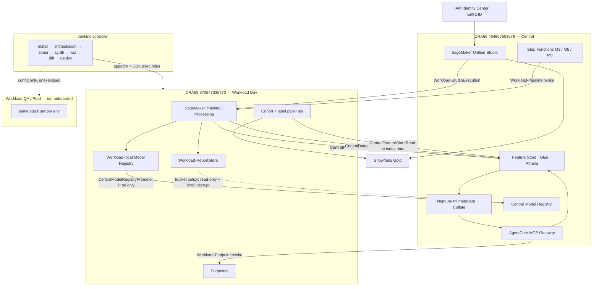

# AR Account Topology and Cross-Account Governance

Account inventory, module placement, runtime flow, and the cross-account access
contract for the Analytics Rewiring (AR) platform. Aligns with HLD §3, §4, §16.

Based on [`cdk_pipeline/environments/*.json`](../../cdk_pipeline/environments/),
[`cdk_pipeline/cdk_stacks/`](../../cdk_pipeline/cdk_stacks/),
[`Jenkinsfile`](../../Jenkinsfile), and the module LLDs in
[`../lld/buildable-modules/`](../lld/buildable-modules/).

Accounts are provisioned by DDIT via AWS Organizations / Control Tower / Landing
Zone (HLD §4). AR applies cost-allocation tags, consumes DDIT-provided roles and
CMKs
---

## 1. Account inventory

Region: `us-east-1` for all accounts.

| Account | ID | DDIT family | Role in AR | Deployed by |
|---|---|---|---|---|
| Central shared services | `484907503679` | DRA66 | Studio domain, Feature Store, Neptune `ml:metadata`, central Model Registry, refresh/monitoring orchestration, MCP Gateway | `pwsa0002037_novaos_sl` — AR consumes it cross-account only |
| Workload — Dev | `970547336770` | DRA65 | Training/processing, cohort+label pipelines, workload-local Model Registry, report store, Dev endpoints | This repo |
| Workload — QA | not supplied | — | Full training on real data; QA validation report (M5 Gate A) | This repo, once onboarded |
| Workload — Prod | not supplied | — | Production training; Prod endpoints (M7) | This repo, once onboarded |

**Identifier conventions.** DRA65 uses role prefix `RRDRAR65DEV_AWS_APP01-`, stack
prefix `APP01-NVSGISRDRAR65`, boundary `PRDRAR65AWSIAMPERMBOUNDARYV1ID01`. DRA66
uses the DRA66 equivalents. A DRA66-prefixed role or boundary paired with the
DRA65 account number names a principal that does not exist.

---

## 2. Module locations

| Module | Central (DRA66) | Workload (DRA65, per env) |
|---|---|---|
| M1 — ML development environment | Studio domain, VPC-only, IdC auth | Training/processing execution; Dev-local registry and endpoints |
| M2 — Feature store | Feature Store, Processing, Glue, Athena (LLD §"Location") | Cross-account reader only |
| M3 — Feature refresh pipeline | EventBridge, Step Functions, Lambda, Processing — all Central | Batch scoring triggered cross-account |
| M4 — Cohort and label engineering | Feature reads as of index date; dataset landing | Step Functions, Processing, validation — all workload |
| M5 — Model training orchestration | Step Functions progression driver | SageMaker Pipelines execute per environment |
| M6 — Model registry and approval | Central registry, Gate D | Workload-local registry per environment |
| M7 — Model serving and MCP | AgentCore Gateway, Gateway Lambda | Real-time endpoints, Batch Transform |
| M8 — Model monitoring and drift | EventBridge, Step Functions, SNS | Endpoint data capture |
| M9 — ML metadata integration | EventBridge, writer Lambdas, Neptune, SQS — all Central | Emits lineage events |

**Flags — no module maps to a stack.** [`app.py`](../../cdk_pipeline/app.py)
instantiates four stacks — `CdkIamDeployRolesStack`, `CdkEcrStack`,
`CdkS3BucketsStack`, `CdkNotificationsStack` — and comments out seven. None of the
twelve stack modules corresponds to M1–M9; the module boundaries in this table
exist only in the LLDs. `CdkSsmParametersStack` is imported at `app.py:21` and
never instantiated, yet it is the only publisher of
`/{app_prefix}/{environment}/kms-key-arn`, which
[`cdk_s3_buckets.py:58-61`](../../cdk_pipeline/cdk_stacks/cdk_s3_buckets.py)
resolves at deploy time. All eight `add_dependency()` calls are
commented out (`app.py:96,107,…`), so deploy ordering is unenforced.

---

## 3. Overall flow

**Training progression (M5).** Central Step Functions assumes
`Workload-PipelineInvoke` for the active environment and starts that account's
SageMaker Pipeline:

1. **Dev** — trains on sanitized data, registers to the workload-local registry. No platform gate.
2. **QA** — full re-training on real data via the sanitized→real column mapping; emits the QA validation report. **Gate A** (DS) → **Gate B** (Workload Lead DS approves YAML + model card), which triggers `Workload-ProdTrainingProvision` IaC.
3. **Prod** — trains to completion on full inputs; emits the Prod validation report. **Gate C** (Workload Lead DS).
4. **Promotion** — only the Prod-trained model crosses to the central registry via `CentralModelRegistryPromote`. **Gate D** (Central/Platform Lead DS) precedes M7 deployment.

Validation reports stay in the workload account's `Workload-ReportStore`; Central
receives read-only access by bucket policy plus KMS decrypt.

**Flags — the flow is not exercised past step 1.** `Workload-PipelineInvoke` and
`Workload-PipelineExecution` are required in all three workload accounts; only the
Dev pair exists. The QA and Prod pipeline ARNs in the IAM policy are placeholder
names pinned to the Dev account —
[`cdk_iam_deploy_roles.py:302-304,316-318`](../../cdk_pipeline/cdk_stacks/cdk_iam_deploy_roles.py)
grant on `arn:aws:sagemaker:us-east-1:970547336770:pipeline/dummy-workload-pipeline-{dev,qa,prod}`.
Lines 426 and 438 grant on `PLACEHOLDER-ecr-repository` and
`PLACEHOLDER-job-prefix-*`.

---

## 4. Cross-account access

**Deploy time (control plane).** Jenkins assumes the DDIT admin role in the target
account via the `assumerole` step of the `f1-shared-lib-bitbucket` shared library
([`Jenkinsfile:173-179`](../../Jenkinsfile) and five further blocks). CDK then
assumes the per-account execution roles from the `roles` block of
`environments/<env>.json` through `DefaultStackSynthesizer`
([`app.py:51-65`](../../cdk_pipeline/app.py)).

**Runtime (data plane).** `sts:AssumeRole` into a named role, or resource policy.
Snowflake is reached over PrivateLink from both account families.

| What crosses | From → To | Mechanism | Identity | Status |
|---|---|---|---|---|
| CloudFormation deploys | Jenkins → workload | control plane HTTPS | DDIT admin role → CDK deploy / CFN exec roles | provisioned (Dev) |
| Interactive training | Central Studio → workload | `sts:AssumeRole` + SageMaker API | `Workload-StudioExecution` — `cdk_iam_deploy_roles.py:622` | provisioned (Dev) |
| Pipeline start | Central SFN → workload | `sagemaker:StartPipelineExecution` | `Workload-PipelineInvoke` — `:286` | provisioned (Dev) |
| Training execution | within workload | SageMaker service role | `Workload-PipelineExecution` — `:342` | provisioned (Dev) |
| Cohort/label orchestration | within workload | SFN + Processing roles | `…CohortLabelStateMachine` `:205`, `…CohortLabelExecution` `:99` | provisioned (Dev) |
| Feature Store ingest | workload → Central store | Processing role | `FeatureStore-IngestRole` — `:524` | provisioned (Dev) |
| Offline/online feature read | workload → Central | `sts:AssumeRole` + S3/Athena/Glue or `GetRecord` | `CentralFeatureStoreRead` | referenced, Central-owned |
| Labeled dataset write | workload → Central | `s3:PutObject` + KMS encrypt | `CentralDatasetWrite` — `dev.json:dra66_dataset_write_role_arn` | referenced, Central-owned |
| Metadata graph read | workload → Central Neptune | `sts:AssumeRole` + SPARQL | `…-novos-neptune-graphread`, granted from the SL repo's `cross_account_access.neptune_graphread` | provisioned both sides |
| Report review | Central reviewers → workload | S3 bucket policy + KMS decrypt, read-only | `Workload-ReportStore` policy | partial — `dev.json:50-52` names a DRA65 role, not the Central reviewer roles |
| Model promotion | workload → Central registry | `sagemaker:CreateModelPackage` | `CentralModelRegistryPromote` | designed only |
| Endpoint inference | Central Gateway → workload | `sagemaker:InvokeEndpoint` | `Workload-EndpointInvoke` | designed only |
| Prod infra provisioning | Gate B → workload Prod | Jenkins + CDK | `Workload-ProdTrainingProvision` | designed only |
| Gold data read | both families → Snowflake | Snowflake PrivateLink | AR service account → read-only role, own schema | provisioned (Dev), evidence in [`../onboarding/evidence/`](../onboarding/evidence/) |
| Practitioner auth | user → Central | SAML/OIDC | IAM Identity Center ← Entra ID | DDIT-provided |

---

## 5. Note on current scope

Built and exercised in **DRA65 Dev** only. Environment files for `dev`, `qa`, and
`prod` exist so that adding an environment is configuration rather than a rewrite.

- **QA and Prod account IDs are a DDIT input.**`qa.json` and
  `prod.json` carry the Dev account ID `970547336770` and the Dev CMK as
  placeholders. The same applies to their CIDRs, subnet/SG IDs and CMK ARNs.
- **AR does not deploy into DRA66.** The Central account is deployed by
  `pwsa0002037_novaos_sl`; AR consumes it cross-account. `CentralFeatureStoreRead`
  and `CentralDatasetWrite` are Central-owned and referenced, not created here.
- **Cost-allocation tag activation sits outside AR.** The six tags are applied at
  synth time in Dev, but activating them as user-defined cost allocation tags is
  done in the Organizations management account — see
  [`AR-00-platform-config.md` §1.2](../onboarding/AR-00-platform-config.md).
